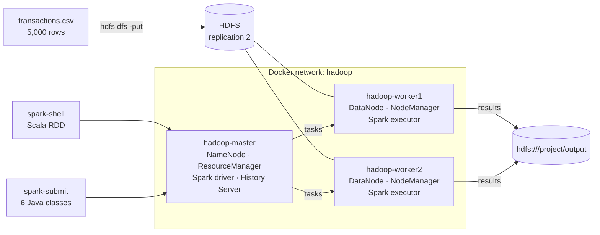
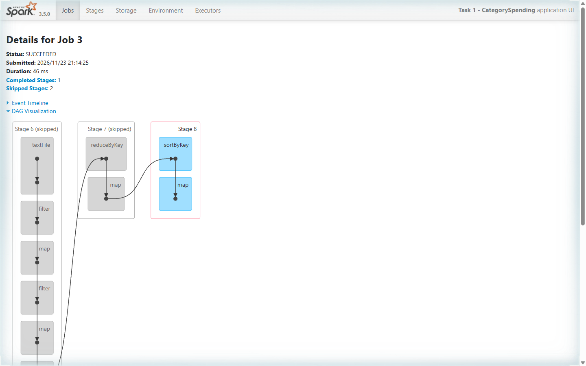
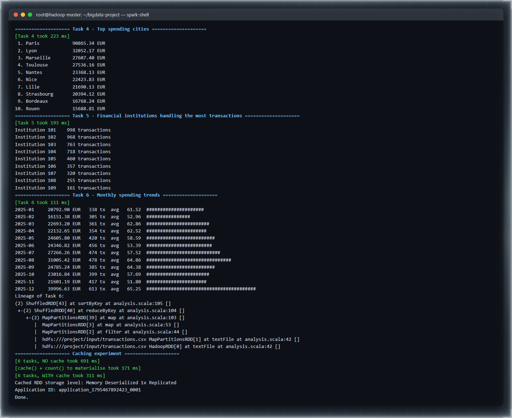

# Financial Transactions Analysis with Apache Spark (RDD API)

Big Data project: a distributed pipeline that analyses **financial transactions stored in HDFS** using the
**Apache Spark RDD API**, run on a **3-node Hadoop/YARN cluster** in Docker.

**Hadoop 3.3.6 (HDFS + YARN)** · **Spark 3.5.0** · **Scala** (Spark Shell) · **Java 8 + Maven** (batch jobs) · **Docker** · Python (data generation, metrics)

📄 **Full report:** [REPORT.md](REPORT.md) · [PDF](REPORT.pdf) (dataset, cluster, code, DAG and performance analysis, with screenshots)

---

## What it does

| Part | Deliverable | Where |
|---|---|---|
| Dataset | 5,000 synthetic transactions (11 fields), reproducible generator | [`data/`](data) |
| I. HDFS | create `/project/input`, upload, verify with `fsck`, show the first records | [`cluster/part1_hdfs.sh`](cluster/part1_hdfs.sh) |
| II. Spark Shell | 6 analyses in Scala with the RDD API, lineage dump and caching experiment | [`spark-shell/analysis.scala`](spark-shell/analysis.scala) |
| III. Batch | Maven project, **one Java class per task**, submitted to YARN, results saved to HDFS | [`spark-batch/`](spark-batch) |
| IV. Execution analysis | RDDs, narrow/wide transformations, stages, tasks, partitioning, caching | [REPORT.md §7](REPORT.md#7-part-iv--spark-execution-analysis-and-dag-observations) |
| Evidence | 23 screenshots (Spark UI, DAGs, HDFS, YARN, terminal) and raw logs | [`docs/`](docs) |

The six analytical tasks:

1. Total transaction amount per category
2. Number of transactions per user
3. Most popular third-party vendors
4. Top spending cities
5. Financial institutions handling the most transactions
6. Monthly spending trends

## Architecture



## Highlights

* **Same results two ways:** the Scala shell analysis and the Java batch jobs produce identical figures.
* **Lazy evaluation in practice:** each Java job runs 4 Spark jobs (`first`, the sampling job hidden in `sortByKey`,
  `saveAsTextFile`, `collect`). Stages already computed are **skipped** thanks to shuffle-file reuse.
* **Map-side combine:** `reduceByKey` shuffles only 18 records (9 categories × 2 partitions) for 5,000 input rows.
* **Caching:** caching the parsed RDD made six aggregations **2.2× faster** (691 ms down to 311 ms).
* **Overhead vs. compute:** for this data size, more than 80 % of a job's wall time is YARN/executor start-up.

<p align="center">
  
  
</p>

## Run it

**Requirements:** Docker Desktop, Python 3, a JDK (11+) and Maven 3.9+. The cluster uses the
[`liliasfaxi/hadoop-cluster`](https://hub.docker.com/r/liliasfaxi/hadoop-cluster) image (Hadoop 3.3.6, Spark 3.5.0, Java 8).

One command (Windows PowerShell) generates the data, starts the cluster and runs Parts I–IV:

```powershell
.\scripts\run-all.ps1            # add -Maven <path\to\mvn.cmd> if mvn is not on PATH
```

Or step by step:

```bash
# 1. Data
python data/generate_transactions.py --rows 5000

# 2. Cluster (first time)
docker network create --driver=bridge hadoop
docker run -itd --net=hadoop -p 9870:9870 -p 8088:8088 --name hadoop-master  --hostname hadoop-master  liliasfaxi/hadoop-cluster
docker run -itd --net=hadoop -p 8040:8042             --name hadoop-worker1 --hostname hadoop-worker1 liliasfaxi/hadoop-cluster
docker run -itd --net=hadoop -p 8041:8042             --name hadoop-worker2 --hostname hadoop-worker2 liliasfaxi/hadoop-cluster
docker exec hadoop-master ./start-hadoop.sh

# 3. Copy files and run each part inside hadoop-master
docker exec hadoop-master mkdir -p /root/bigdata-project
docker cp data/transactions.csv          hadoop-master:/root/bigdata-project/
docker cp spark-shell/analysis.scala     hadoop-master:/root/bigdata-project/
docker cp cluster/.                      hadoop-master:/root/bigdata-project/   # the .sh scripts
docker exec -it hadoop-master bash
  cd ~/bigdata-project
  bash part1_hdfs.sh                 # Part I
  bash start-history-server.sh       # Spark UI for finished apps on :18080
  bash setup-spark-yarn-archive.sh   # once: share Spark's jars instead of uploading them per job
  bash run-spark-shell.sh            # Part II
  # Part III: build on the host (cd spark-batch && mvn package), docker cp the jar, then
  bash run-batch-jobs.sh             # all six classes (or: bash run-batch-jobs.sh TopCities)
```

Web UIs: HDFS http://localhost:9870 · YARN http://localhost:8088 · Spark History http://localhost:18080
(`run-all.ps1` starts a small `alpine/socat` container to expose the Spark UI ports).

## Repository layout

```
data/                     generate_transactions.py, transactions.csv
cluster/                  scripts run inside hadoop-master (HDFS, spark-shell, spark-submit, history server)
spark-shell/analysis.scala
spark-batch/              Maven project
  src/main/java/bigdata/transactions/
    Transactions.java                     shared loading/parsing helpers
    CategorySpending.java                 Task 1
    TransactionsPerUser.java              Task 2
    TopVendors.java                       Task 3
    TopCities.java                        Task 4
    InstitutionWithMostTransactions.java  Task 5
    MonthlySpendingTrends.java            Task 6
scripts/                  run-all.ps1, spark_metrics.py (History Server REST API), render_terminal.py
docs/outputs/             raw logs of every run, HDFS results, stage/task metrics
docs/screenshots/         Spark UI, DAGs, HDFS, YARN and terminal captures
REPORT.md                 project report
```
