# Financial Transactions Analysis using Apache Spark (RDD API)

**Big Data project report · 2025-2026**
Author: Dharun Arunan · Supervisor: Dr. Marwa Brichni

---

## Contents

1. [Introduction](#1-introduction)
2. [Dataset description](#2-dataset-description)
3. [Cluster configuration](#3-cluster-configuration)
4. [Part I: Data preparation in HDFS](#4-part-i--data-preparation-in-hdfs)
5. [Part II: Interactive analysis with the Spark Shell](#5-part-ii--interactive-analysis-with-the-spark-shell)
6. [Part III: Batch processing in Java](#6-part-iii--batch-processing-in-java-source-code-explanations)
7. [Part IV: Spark execution analysis and DAG observations](#7-part-iv--spark-execution-analysis-and-dag-observations)
8. [Performance observations](#8-performance-observations)
9. [Conclusion](#9-conclusion)

---

## 1. Introduction

Banks and payment providers record millions of card payments, transfers and direct debits every day. Turning those records into
business indicators (where customers spend, which merchants and cities generate the most volume, how spending varies over the
year) is a typical **batch analytics** workload: the data is large, append-only, and every question is an aggregation over
the full history.

This project builds that pipeline with **Apache Spark's RDD API** on a small distributed cluster:

* a synthetic dataset of **5,000 financial transactions** is generated and stored in **HDFS**;
* six analytical questions are answered **interactively in the Spark Shell** (Scala);
* the same six questions are implemented as **Java batch applications** (Maven, one class per task) and submitted to
  **YARN**;
* the execution of the jobs is examined in the **Spark Web UI / History Server**: RDD lineage, narrow vs. wide
  transformations, stages, tasks, partitioning and the effect of caching.

All commands, logs and screenshots in this report come from real runs on the cluster described in section 3.

## 2. Dataset description

The dataset is generated by [`data/generate_transactions.py`](data/generate_transactions.py) (fixed seed, so it is
reproducible) and committed as [`data/transactions.csv`](data/transactions.csv).

| Property | Value |
|---|---|
| Records | **5,000** transactions + 1 header line |
| Size | 472,714 bytes (461.6 KB) |
| Period | 1 Jan 2025 – 31 Dec 2025, sorted chronologically |
| Users / accounts | 249 active users, 1–2 bank accounts each |
| Distinct values | 9 categories, 45 vendors, 10 cities, 9 financial institutions |

| Column | Type | Example | Notes |
|---|---|---|---|
| `user_id` | string | `U0184` | 250 user profiles, activity follows a log-normal distribution |
| `transaction_id` | string | `TXN0000001` | unique, follows time order |
| `bank_account_id` | string | `ACC59823245` | each account belongs to one institution |
| `financial_institution_id` | integer | `101` | 101–109, weighted by market share |
| `date` | timestamp | `2025-01-01 07:10:37` | `yyyy-MM-dd HH:mm:ss` |
| `third_party` | string | `Carrefour` | vendor / partner; each vendor belongs to one category |
| `category` | string | `Food` | Food, Restaurants, Shopping, Travel, Transport, Utilities, Health, Entertainment, Education |
| `transaction_amount` | float | `74.39` | EUR, log-normal per category (Travel ~180 €, Entertainment ~18 €) |
| `city` | string | `Paris` | 80 % of a user's transactions happen in their home city |
| `payment_method` | string | `Card` | Card, Contactless, Transfer, Direct Debit, Mobile |
| `currency` | string | `EUR` | |

The data is random but **structured** so the analyses reveal patterns: seasonality (more spending in July/August and a
December peak, Travel concentrated in holiday months), population-weighted cities, and market-share-weighted banks.
No field contains a comma, so lines can be parsed with a simple `split(",")`.

## 3. Cluster configuration

The cluster is the three-container setup suggested by the brief (image `liliasfaxi/hadoop-cluster`) running in
Docker Desktop on Windows 11 (WSL 2 backend), connected by the Docker bridge network `hadoop`.

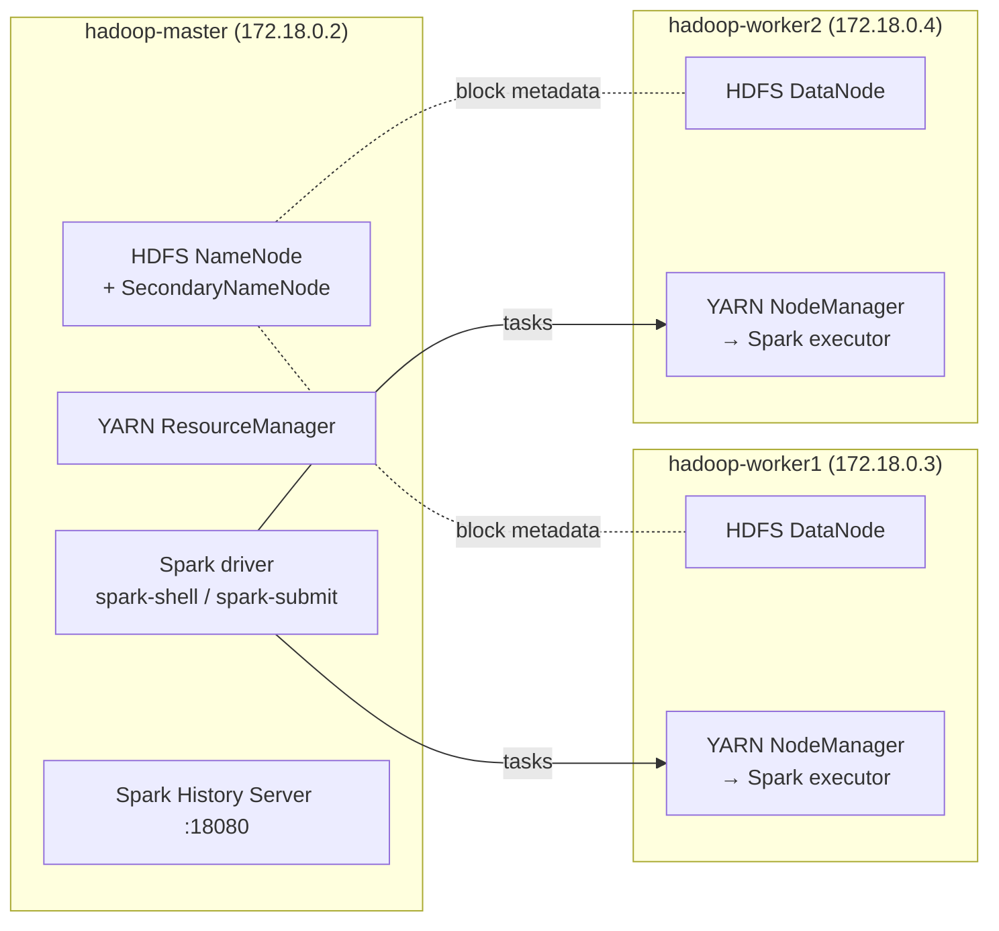

| Component | Version / setting |
|---|---|
| Hadoop (HDFS + YARN) | 3.3.6, replication factor 2, block size 128 MB |
| Spark | 3.5.0 (Scala 2.12.18), `spark.master = yarn`, client deploy mode |
| Java | OpenJDK 1.8.0_402 in the containers; jobs compiled with `--release 8` |
| YARN NodeManagers | 2 (worker1, worker2), 8 GB / 8 vCores advertised each |
| Executors per application | 2 × (1 core, 1 GB): one per worker |
| Event logs | `hdfs:///spark-logs`, served by the Spark History Server |

Two live DataNodes and two NodeManagers:

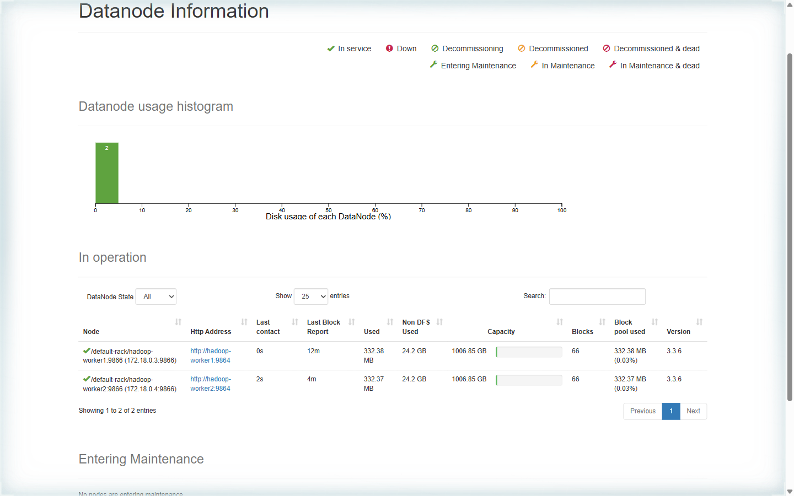
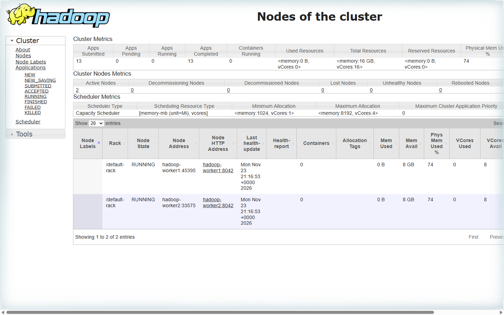

> The Spark driver UI (port 4040) and History Server (18080) are not published by the original containers, so a tiny
> `alpine/socat` container on the same Docker network forwards them to the host (`scripts/run-all.ps1` creates it).

## 4. Part I: Data preparation in HDFS

Script: [`cluster/part1_hdfs.sh`](cluster/part1_hdfs.sh) · full output: [`docs/outputs/part1_hdfs.txt`](docs/outputs/part1_hdfs.txt)

| Task | Command |
|---|---|
| 1. Create the directory | `hdfs dfs -mkdir -p /project/input` |
| 2. Upload the CSV | `hdfs dfs -put -f transactions.csv /project/input/transactions.csv` |
| 3. Verify the upload | `hdfs dfs -ls /project/input`, `hdfs dfs -du -h …`, `hdfs fsck … -files -blocks -locations` |
| 4. Display the first records | `hdfs dfs -cat /project/input/transactions.csv \| head -n 11` |

`fsck` confirms the file is stored as **one block** (472 KB < 128 MB block size) with **2 live replicas**, one on each
DataNode, and the filesystem is `HEALTHY`. `wc -l` returns 5,001 lines (header + 5,000 records).

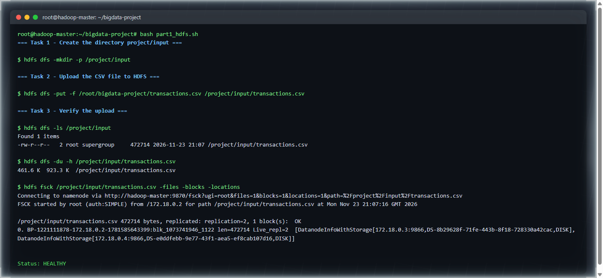
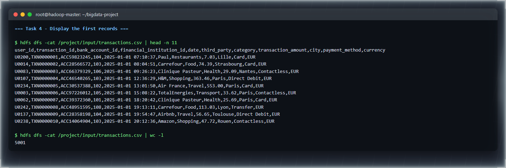
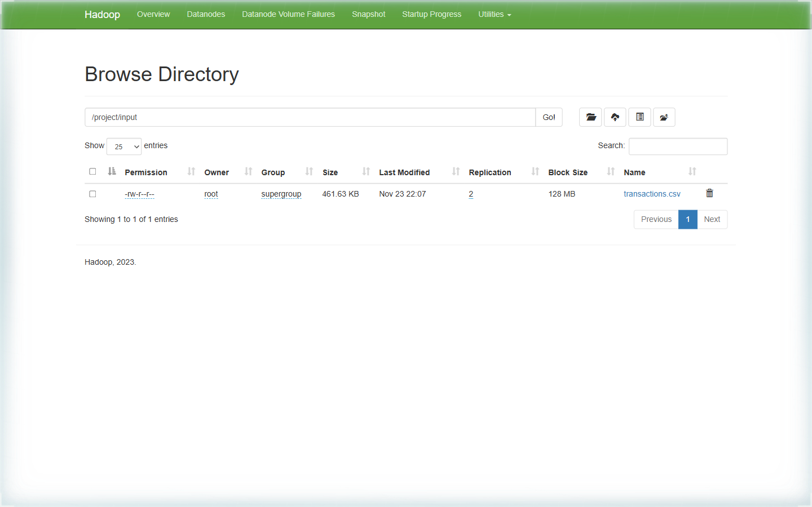

## 5. Part II: Interactive analysis with the Spark Shell

Script: [`spark-shell/analysis.scala`](spark-shell/analysis.scala), run with
`spark-shell --master yarn --num-executors 2 -i analysis.scala` · output: [`docs/outputs/part2_spark_shell.txt`](docs/outputs/part2_spark_shell.txt)

The dataset is loaded exactly as in the brief, then split once into an `RDD[Array[String]]` that every task reuses:

```scala
val data = sc.textFile("hdfs:///project/input/transactions.csv")
val header = data.first()
val transactions = data.filter(line => line != header)
val fields = transactions.map(_.split(","))      // 0 user … 4 date, 5 vendor, 6 category, 7 amount, 8 city
```

| Task | RDD pipeline |
|---|---|
| 1. Amount per category | `fields.map(f => (f(6), f(7).toDouble)).reduceByKey(_ + _).sortBy(_._2, false)` |
| 2. Transactions per user | `fields.map(f => (f(0), 1)).reduceByKey(_ + _)` → `sortBy(...).take(10)` and `count()` |
| 3. Popular vendors | `map(f => (f(5), (1, amount))).reduceByKey` (count and amount together) → `sortBy(count).take(10)` |
| 4. Top spending cities | `map(f => (f(8), amount)).reduceByKey(_ + _).sortBy(_._2, false).take(10)` |
| 5. Institutions | `map(f => (f(3).toInt, 1)).reduceByKey(_ + _).sortBy(_._2, false).collect()` |
| 6. Monthly trends | `map(f => (f(4).substring(0, 7), (amount, 1))).reduceByKey(...).sortByKey()` |

`sc.setJobDescription(...)` labels every job, so each task is easy to find in the Spark UI.

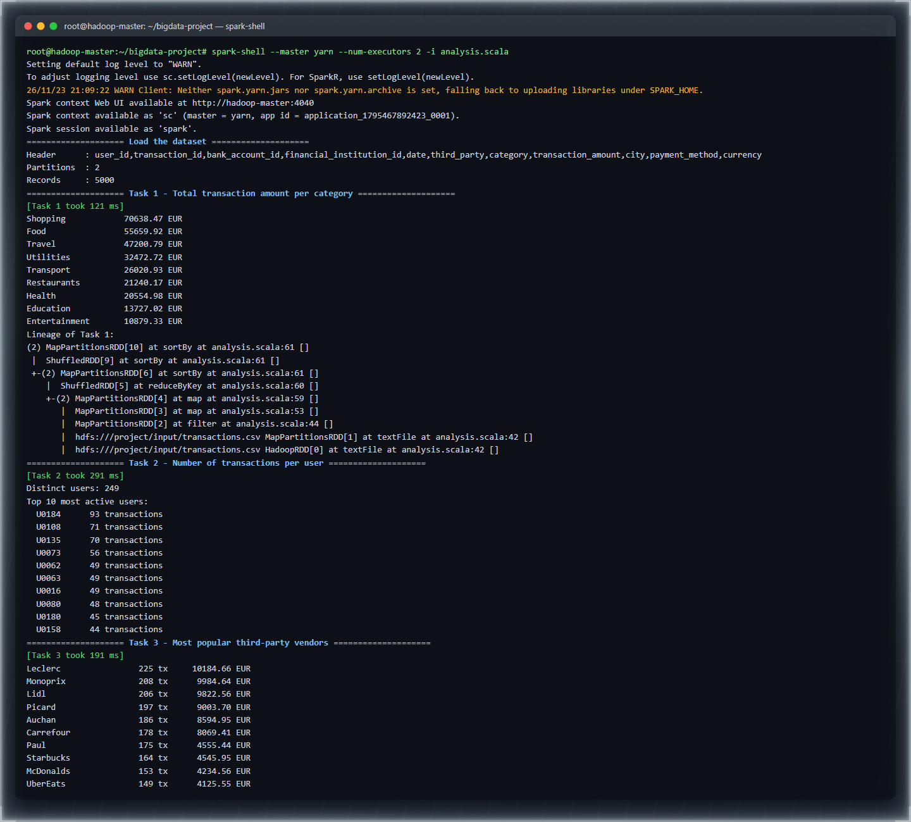
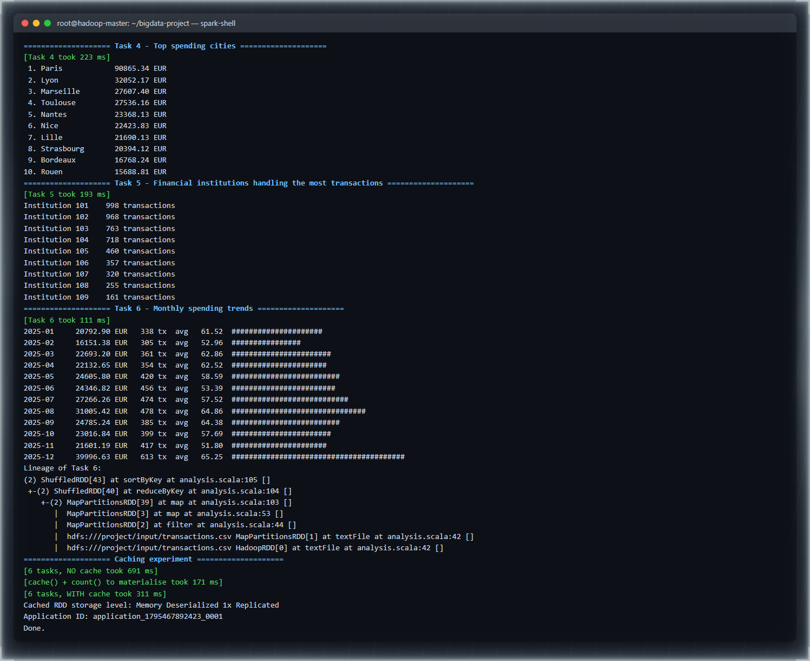
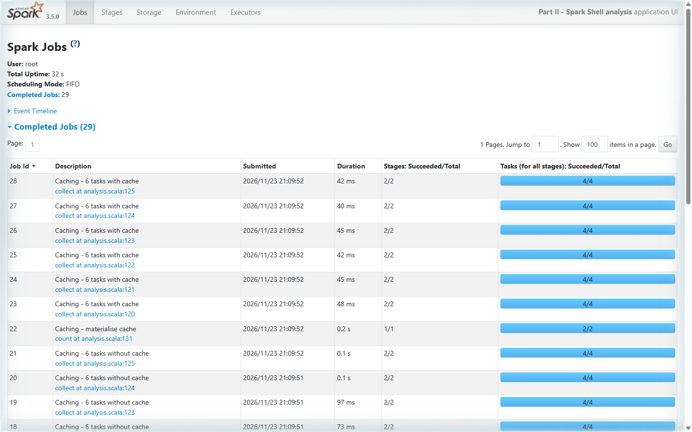

### Results

| Category | Total (EUR) | | City | Total (EUR) | | Institution | Transactions |
|---|---:|---|---|---:|---|---|---:|
| Shopping | 70,638.47 | | Paris | 90,865.34 | | 101 | 998 |
| Food | 55,659.92 | | Lyon | 32,052.17 | | 102 | 968 |
| Travel | 47,200.79 | | Marseille | 27,607.40 | | 103 | 763 |
| Utilities | 32,472.72 | | Toulouse | 27,536.16 | | 104 | 718 |
| Transport | 26,020.93 | | Nantes | 23,368.13 | | 105 | 460 |
| Restaurants | 21,240.17 | | Nice | 22,423.83 | | 106 | 357 |
| Health | 20,554.98 | | Lille | 21,690.13 | | 107 | 320 |
| Education | 13,727.02 | | Strasbourg | 20,394.12 | | 108 | 255 |
| Entertainment | 10,879.33 | | Bordeaux | 16,768.24 | | 109 | 161 |
| **Total** | **298,394.33** | | Rouen | 15,688.81 | | | |

* **Users:** 249 distinct users, 20.1 transactions per user on average. The most active is `U0184` (93), followed by
  `U0108` (71) and `U0135` (70): a long-tail distribution, as with real customers.
* **Vendors:** grocery chains dominate by count (Leclerc 225, Monoprix 208, Lidl 206); fast-food and coffee follow (Paul,
  Starbucks, McDonald's). Food is frequent but cheap, whereas Travel is rare but expensive, so Travel ranks 3rd by amount.
* **Monthly trend:** December is the peak (39,996.63 € / 613 transactions, +85 % vs. November), followed by August
  (31,005.42 €) and July. February is the lowest month (16,151.38 €).

## 6. Part III: Batch processing in Java (source code explanations)

Maven project: [`spark-batch/`](spark-batch) · output: [`docs/outputs/part3_batch_jobs.txt`](docs/outputs/part3_batch_jobs.txt)
(results) and [`docs/outputs/part3_batch_jobs_full_log.txt`](docs/outputs/part3_batch_jobs_full_log.txt) (full Spark job logs).

**Build.** [`pom.xml`](spark-batch/pom.xml) declares `spark-core_2.12:3.5.0` with scope `provided` (the cluster already
ships Spark, so the jar is only 26 KB) and compiles with `maven.compiler.release = 8` to match the cluster's Java 8.

**Shared code.** [`Transactions.java`](spark-batch/src/main/java/bigdata/transactions/Transactions.java):
* `context(name)` creates the `JavaSparkContext`;
* `lines()` reproduces the brief's header removal (`first()` + `filter`);
* `load()` splits each line, **drops malformed rows** (wrong column count or non-numeric amount) instead of failing, and
  maps them to a serializable `Txn` object;
* `deleteIfExists()` removes the previous output directory via the Hadoop `FileSystem` API (Spark refuses to overwrite).

**One class per task**, each reading `hdfs:///project/input/transactions.csv` (or `args[0]`), writing its full result to
`hdfs:///project/output/<task>` (or `args[1]`) and printing a summary:

| Class | Logic |
|---|---|
| [`CategorySpending`](spark-batch/src/main/java/bigdata/transactions/CategorySpending.java) | `mapToPair(category, amount)` → `reduceByKey(Double::sum)` → swap → `sortByKey(false)` → share of total |
| [`TransactionsPerUser`](spark-batch/src/main/java/bigdata/transactions/TransactionsPerUser.java) | `mapToPair(user, 1)` → `reduceByKey` → all users saved; top 10 + mean printed |
| [`TopVendors`](spark-batch/src/main/java/bigdata/transactions/TopVendors.java) | `(vendor, (1, amount))` → one `reduceByKey` for count and amount → sorted by count |
| [`TopCities`](spark-batch/src/main/java/bigdata/transactions/TopCities.java) | `(city, amount)` → `reduceByKey` → sorted by total spending |
| [`InstitutionWithMostTransactions`](spark-batch/src/main/java/bigdata/transactions/InstitutionWithMostTransactions.java) | `(institution, 1)` → `reduceByKey` → ranking with market share |
| [`MonthlySpendingTrends`](spark-batch/src/main/java/bigdata/transactions/MonthlySpendingTrends.java) | `(yyyy-MM, (amount, 1))` → `reduceByKey` → `sortByKey()`; prints total, count, average and month-over-month change |

Results are written with `coalesce(1)` so each task produces a single `part-00000` file, which is convenient for small
outputs (narrow, no extra shuffle).

Submission (all six classes via [`cluster/run-batch-jobs.sh`](cluster/run-batch-jobs.sh)):

```bash
spark-submit --master yarn --deploy-mode client --class bigdata.transactions.CategorySpending \
  --num-executors 2 --executor-cores 1 --executor-memory 1g \
  --conf spark.eventLog.enabled=true --conf spark.eventLog.dir=hdfs:///spark-logs \
  spark-transactions-batch.jar
```

All six applications finished with exit code 0, and their figures are **identical to the Spark Shell results**, which
cross-validates both implementations.

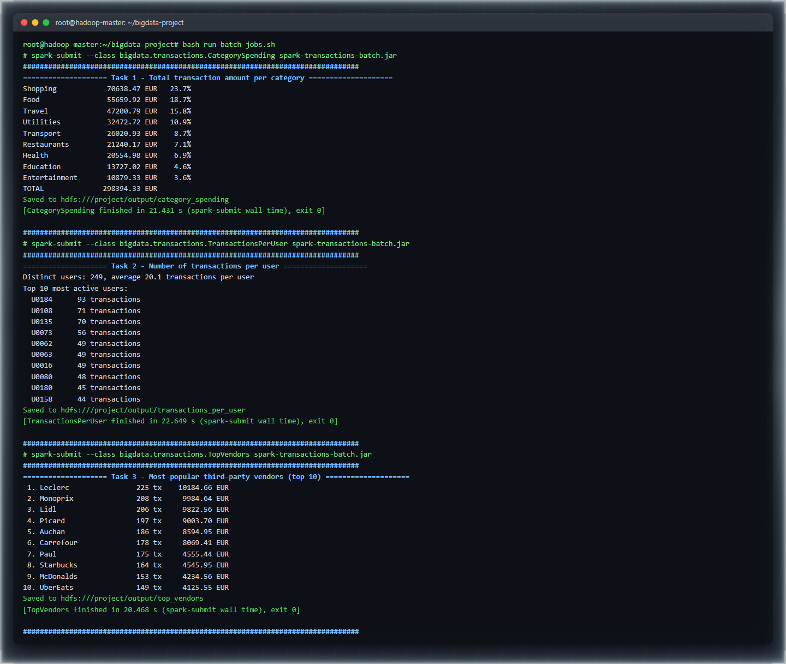
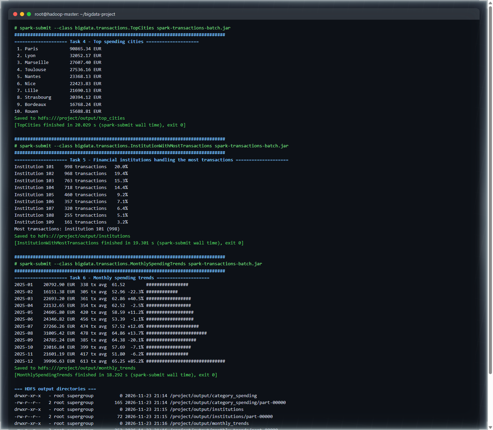
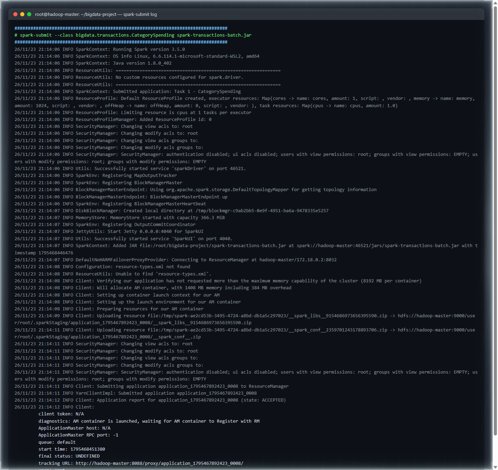
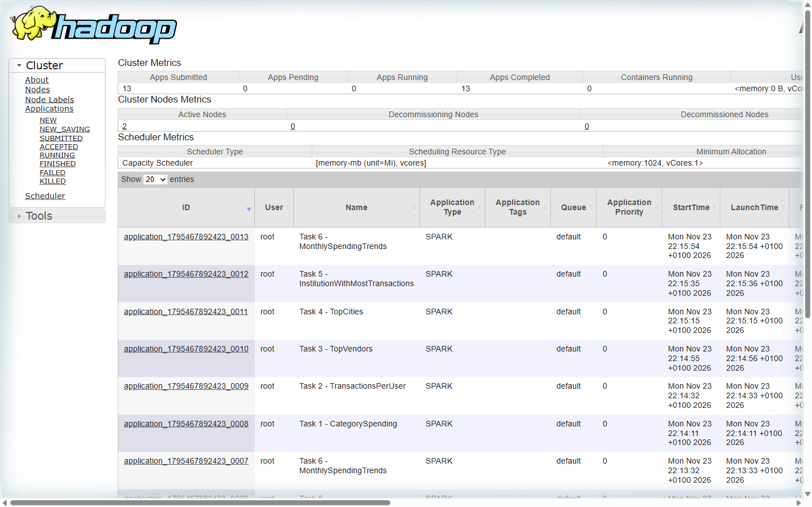
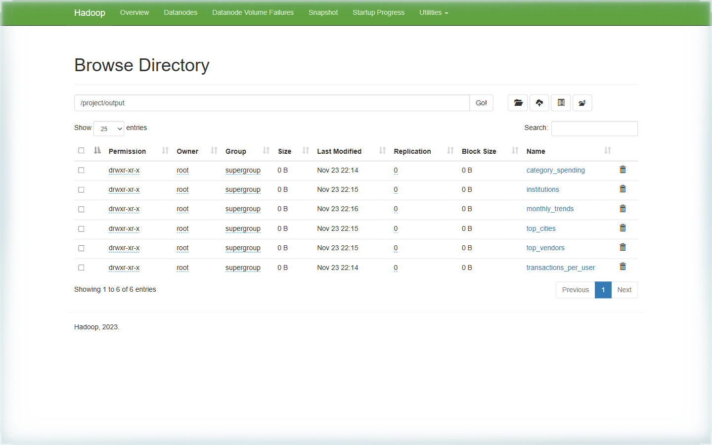
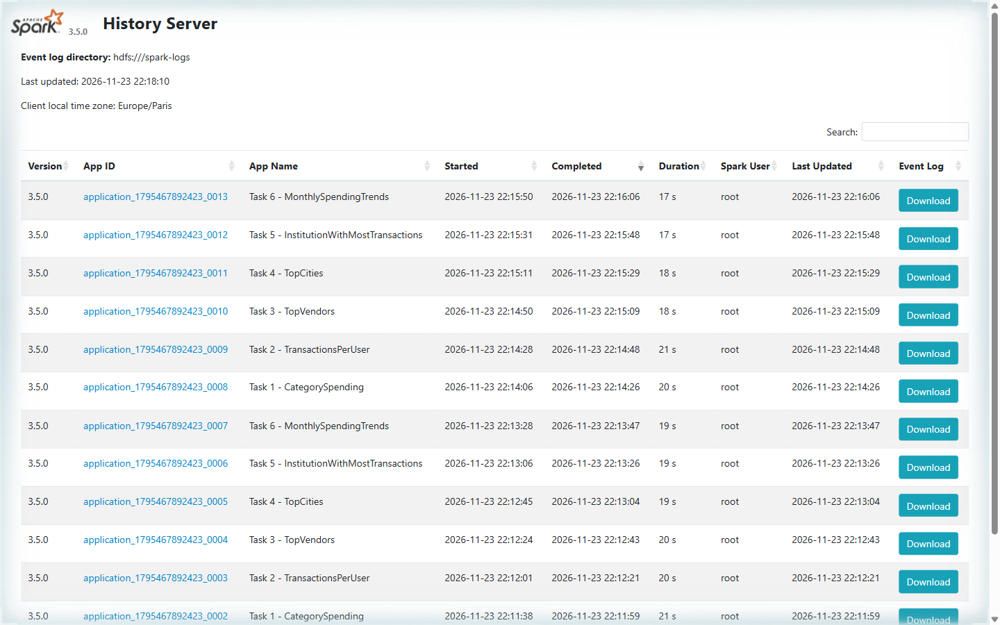

## 7. Part IV: Spark execution analysis and DAG observations

Two Java applications are analysed: **Task 1, CategorySpending** (`application_…_0008`) and **Task 6,
MonthlySpendingTrends** (`application_…_0013`). Figures come from the Spark UI and its REST API
([`scripts/spark_metrics.py`](scripts/spark_metrics.py) → [`docs/outputs/part4_metrics.md`](docs/outputs/part4_metrics.md)).

### 7.1 Task 1: CategorySpending

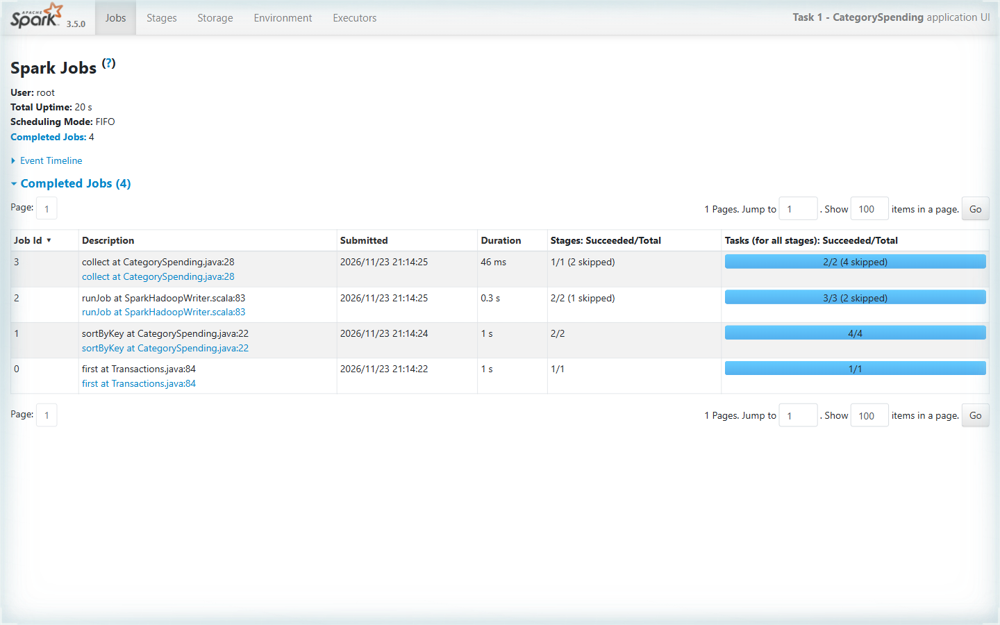

**1. Which RDDs were created?**

| RDD | Created by | Kind |
|---|---|---|
| `HadoopRDD[0]`, `MapPartitionsRDD[1]` | `sc.textFile(...)` | input (lines of the HDFS file) |
| `MapPartitionsRDD[2]` | `filter(line != header)` | header removed |
| `MapPartitionsRDD[3]`, `[4]`, `[5]` | `map(split)`, `filter(valid)`, `map(Txn::new)` | parsed transactions |
| `MapPartitionsRDD[6]` | `mapToPair(category, amount)` | pair RDD |
| `ShuffledRDD[7]` | `reduceByKey(Double::sum)` | totals per category |
| `MapPartitionsRDD[8]` | `mapToPair(swap)` | (total, category) |
| `MapPartitionsRDD[9]`, `[10]` | internal to `sortByKey` | key sample used to compute the range bounds |
| `ShuffledRDD[11]` | `sortByKey(false)` | sorted totals |
| `MapPartitionsRDD[12]` | `mapToPair(swap)` | (category, total) |
| `MapPartitionsRDD[13]`, `CoalescedRDD[14]`, `MapPartitionsRDD[15]` | `map(toString)`, `coalesce(1)`, `saveAsTextFile` | output lines written to HDFS |

The stage DAG in the UI shows the same chain (`textFile → filter → map → filter → map → mapToPair`):

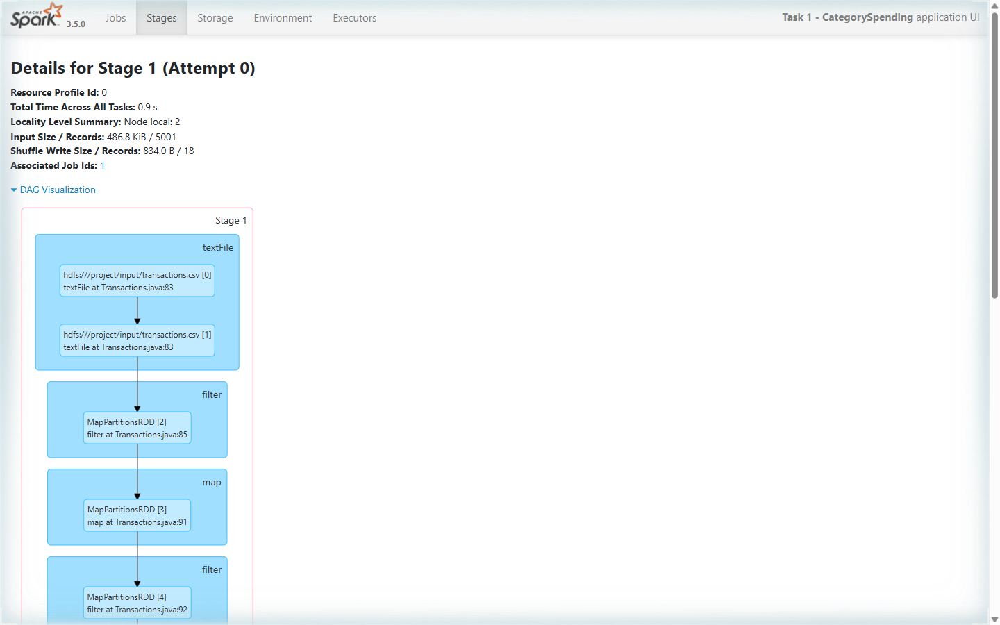

**2. Transformations used:** `filter`, `map`, `mapToPair`, `reduceByKey`, `sortByKey`, `coalesce`.

**3. Narrow transformations:** `textFile`'s internal `map`, `filter` (×2), `map` (×2), `mapToPair` (×3), `map`, and
`coalesce(1)`. Each output partition depends on **one** parent partition, so they are pipelined inside a single task
without moving data.

**4. Wide transformations:** `reduceByKey` (hash-partitioned shuffle by category) and `sortByKey` (range-partitioned
shuffle). Each needs records with the same key, or the same key range, from **all** parent partitions, so Spark ends
the stage there and writes shuffle files.

**5. How many stages?** Nine stage IDs were created: **6 executed and 3 skipped.** Each shuffle boundary starts a new stage:

| Job | Action | Stages | What happens |
|---|---|---|---|
| 0 | `first()` (header) | 0 | 1 task reads the beginning of the file (64 KB) |
| 1 | `sortByKey` (*sampling job*) | 1 → 2 | stage 1: read, parse, map-side combine, **shuffle write**; stage 2: sample keys to compute range bounds |
| 2 | `saveAsTextFile` | ~~3~~ → 4 → 5 | stage 3 **skipped** (shuffle files reused); 4: reduce + range shuffle write; 5: `coalesce(1)` + write to HDFS |
| 3 | `collect()` | ~~6~~ ~~7~~ → 8 | 2 stages **skipped**; stage 8 reads the sorted shuffle output |

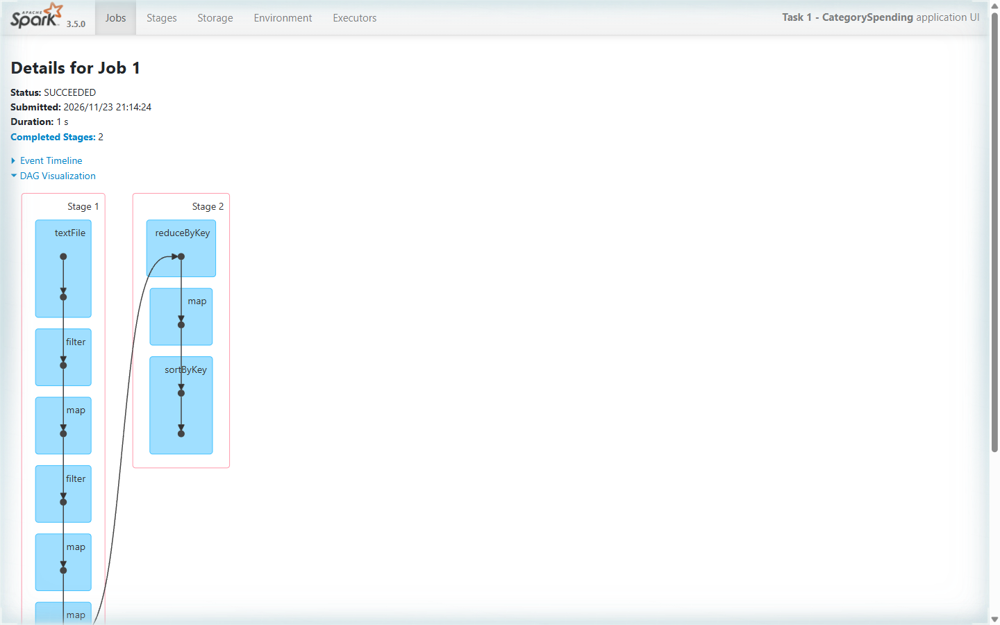
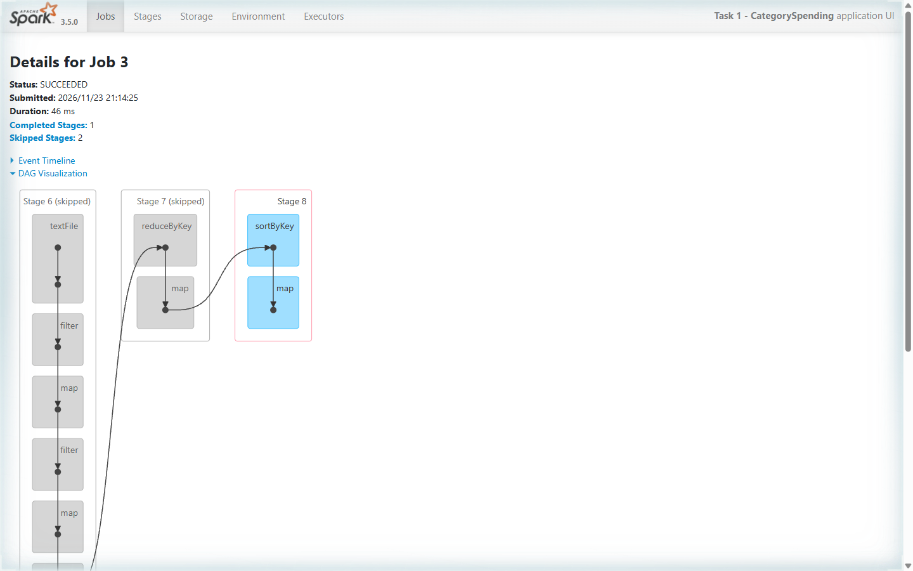
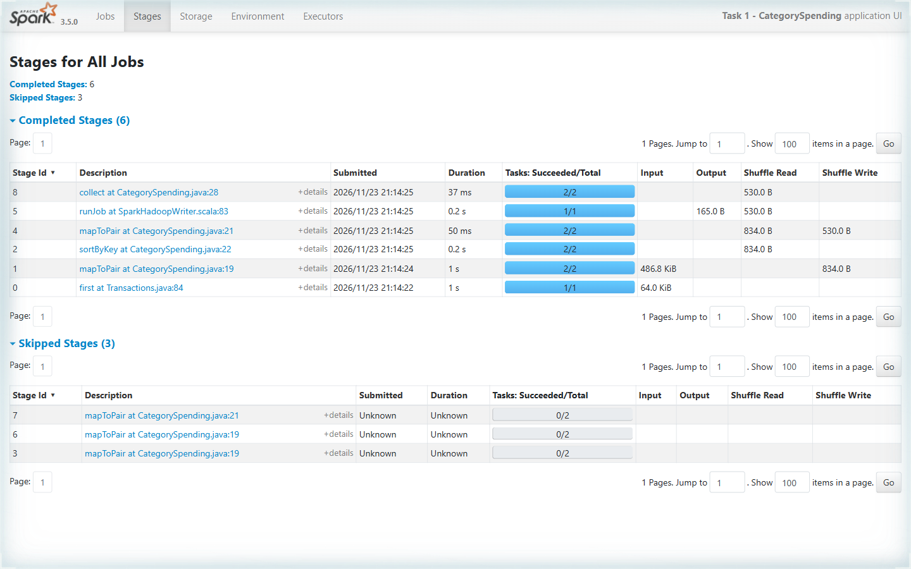

**6. Which actions triggered execution?** `first()`, `saveAsTextFile()` and `collect()`, plus `sortByKey`. Although
`sortByKey` is a transformation, it is *not fully lazy*: to build its `RangePartitioner`, Spark samples the keys
immediately, which launches job 1. Everything else was lazy: nothing ran until an action needed the data.

**7. How many tasks were launched?** **10 tasks**: 1 (job 0) + 2 + 2 (job 1) + 2 + 1 (job 2) + 2 (job 3). They were
split evenly between the two executors, **5 on hadoop-worker1 and 5 on hadoop-worker2**:

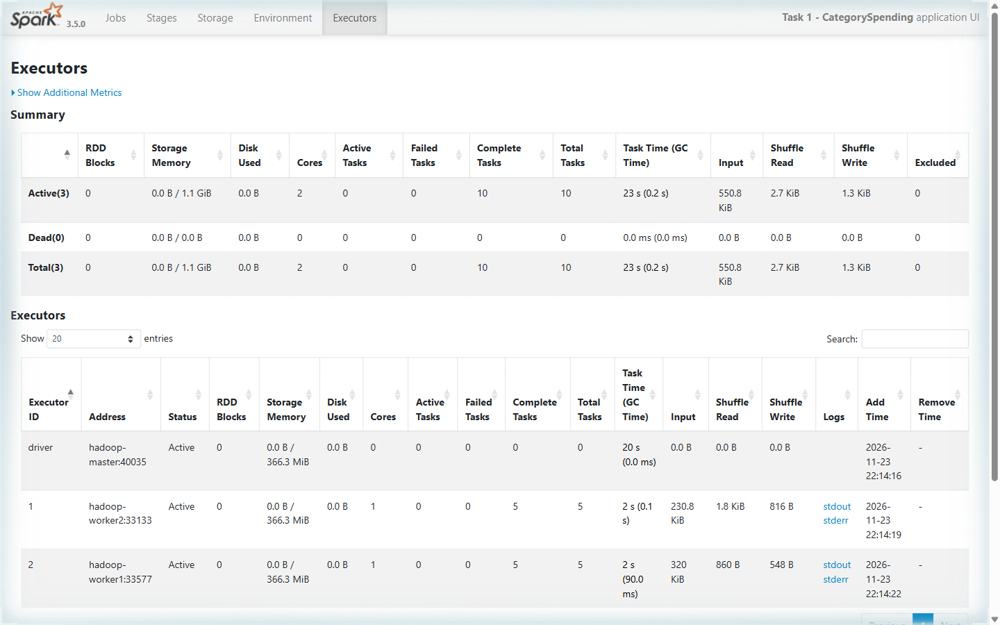

**8. How did Spark partition the data?**
* **Input:** the 472 KB file is a single HDFS block, but `textFile` uses `minPartitions = min(defaultParallelism, 2) = 2`,
  so the block was split into **2 input splits** (2 partitions). Both tasks ran **NODE_LOCAL**: with replication
  factor 2, every worker holds a copy of the block.
* **Shuffle 1 (`reduceByKey`):** a `HashPartitioner` with 2 partitions (same as the parent). Thanks to **map-side
  combining**, stage 1 wrote only **18 shuffle records** (9 categories × 2 input partitions) for 5,001 input lines.
* **Shuffle 2 (`sortByKey`):** a `RangePartitioner` with 2 partitions, whose bounds come from the sampling job. 9
  records were shuffled.
* **Output:** `coalesce(1)` merges into 1 partition without a shuffle, so 1 task writes 1 file.

**9. Would caching improve performance?** Only a little in this application. The two later jobs already **skip**
the input stages, because Spark keeps and reuses shuffle files. The input is read from HDFS twice (job 0 reads the header,
job 1 reads everything), and caching the parsed RDD would remove one of those reads, a few hundred ms at most for
5,000 rows. Caching pays off when **several actions reuse the same RDD before any shuffle**, which is the case in the
Spark Shell session (section 8.2). There, caching the parsed `fields` RDD made the six aggregations **2.2× faster**.

### 7.2 Task 6: MonthlySpendingTrends

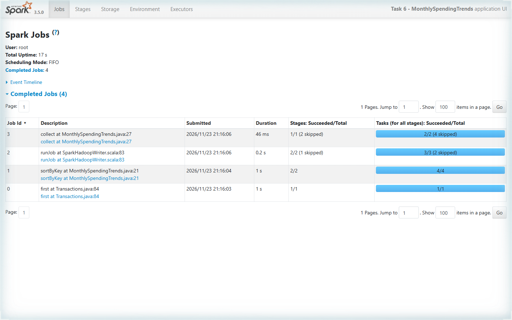
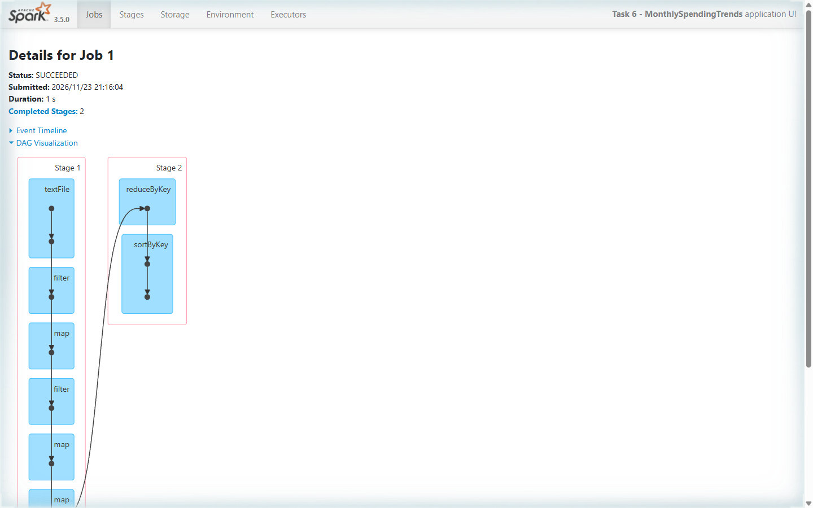
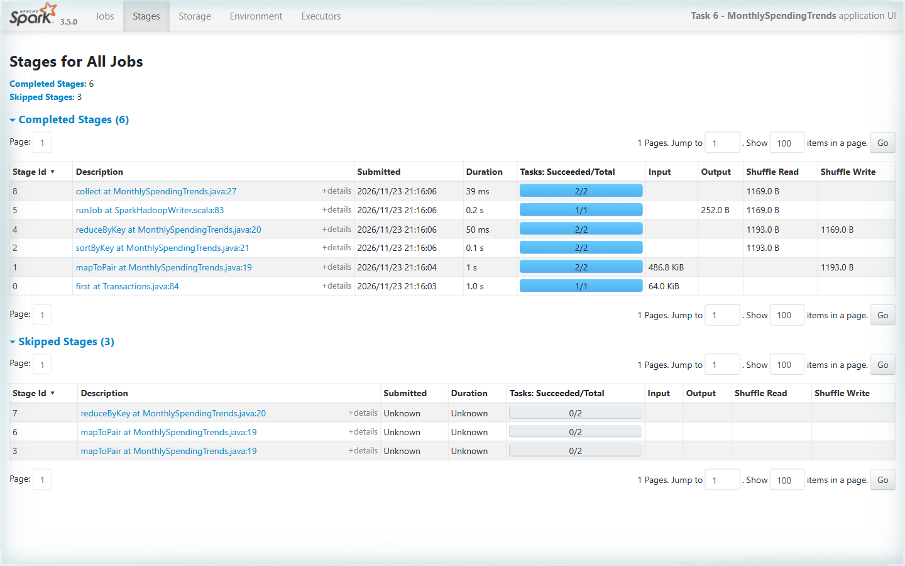

1. **RDDs:** the same input chain (`HadoopRDD → filter → map → filter → map`), then `mapToPair(month, (amount, 1))`,
   `ShuffledRDD` from `reduceByKey`, `ShuffledRDD` from `sortByKey`, then `map(toString)` → `coalesce(1)`.
2. **Transformations:** `filter`, `map`, `mapToPair`, `reduceByKey`, `sortByKey`, `coalesce`.
3. **Narrow:** `filter`, `map`, `mapToPair`, `map`, `coalesce(1)`. Extracting the month (`date.substring(0, 7)`)
   is a narrow, per-record operation.
4. **Wide:** `reduceByKey` (sum and count per month in a single pass, using a `(amount, count)` tuple) and `sortByKey`
   (chronological order). Unlike Task 1, the keys are sorted directly, so no `swap` step is needed.
5. **Stages:** again **6 executed + 3 skipped**: job 1 = stages 1 → 2, job 2 = (3 skipped) → 4 → 5, job 3 = (6, 7
   skipped) → 8.
6. **Actions:** `first()`, the `sortByKey` sampling job, `saveAsTextFile()` and `collect()`. That makes 4 jobs.
7. **Tasks:** **10 tasks**, 6 on hadoop-worker2 and 4 on hadoop-worker1. The scheduler balances tasks by free
   executor slots, not strictly 50/50.
8. **Partitioning:** 2 input splits (NODE_LOCAL), then 2 hash partitions, then 2 range partitions, then 1 output
   partition. The interesting effect is in the shuffle write: **13 records for 12 months**. The CSV is sorted by date,
   so the first input split holds roughly January–July and the second July–December. Map-side combining produces one
   record per month per split, and only **July** appears in both splits.
9. **Caching:** same conclusion as Task 1. Within this single-question application, shuffle reuse already avoids
   recomputation. Caching becomes worthwhile if several monthly indicators (per category, per city…) are computed from the
   same parsed RDD in one application.

### 7.3 Summary of the Spark Shell session

The interactive session (`application_…_0001`) ran **29 jobs, 53 executed stages (9 skipped) and 101 tasks** on 2
executors (51 on worker2 and 50 on worker1). Every `sortBy` produced an extra sampling job, and `take(10)` first ran
**1 task** on a single partition, then scanned the rest only when needed (visible as 1-task stages in the metrics).

## 8. Performance observations

### 8.1 Where the time goes

| Application | Wall time (spark-submit) | Sum of job durations | Share spent in Spark jobs |
|---|---:|---:|---:|
| Task 1: CategorySpending | 21.4 s | 2.98 s | ~14 % |
| Task 6: MonthlySpendingTrends | 18.3 s | 2.71 s | ~15 % |

For 5,000 rows, **more than 80 % of the time is fixed overhead**: starting the YARN ApplicationMaster, launching two
executor containers (executors registered 2–6 s after the driver), and uploading Spark's jars to HDFS on every
submission (`WARN Client: Neither spark.yarn.jars nor spark.yarn.archive is set`). Each NodeManager also kept its own
copy of those jars per application, about 4.1 GB per worker after 13 runs.

This was fixed afterwards with [`cluster/setup-spark-yarn-archive.sh`](cluster/setup-spark-yarn-archive.sh), which
uploads the jars once to `hdfs:///spark-jars/spark-libs.jar` and sets `spark.yarn.archive`. Each worker now keeps a
single shared 323 MB copy. The second job submitted after the change finished in **13.3 s instead of ~19 s**. (The
measurements in this report were taken before the change.)

Inside the jobs, the **first stage that touches the data is the slowest** (stage 1: 866 ms of executor time), because of
JVM class loading and JIT warm-up. Equivalent stages later in the same application take 20–40 ms. Shuffles are tiny
(< 1.2 KB) thanks to map-side combining, so network cost is negligible.

### 8.2 Caching experiment (Spark Shell)

The six aggregations were run twice on the same parsed RDD, first without and then with `cache()`:

| Run | Time |
|---|---:|
| 6 aggregations, **no cache** (each re-reads HDFS and re-splits every line) | **691 ms** |
| `cache()` + `count()` to materialise the cache | 171 ms (one-off) |
| 6 aggregations, **with cache** | **311 ms** (2.2× faster) |

Per stage, the map-side run time fell from 37–58 ms to 8–16 ms. In the UI, the cached stages report an *input* of
3,454.6 KB per stage: the deserialized objects read from memory (`Memory Deserialized 1x Replicated`), not from HDFS.
Even with only 5,000 records, caching pays for itself after two reuses. On a real dataset of millions of rows, the
saving would be seconds to minutes per query.

### 8.3 Scalability notes

* With only 2 input partitions, at most 2 tasks run in parallel, regardless of cluster size. For a large file,
  HDFS blocks (128 MB) would give one partition per block. For small files, `textFile(path, n)` or `repartition(n)`
  can increase parallelism.
* `reduceByKey` was preferred over `groupByKey` everywhere, so values are combined before the shuffle (18 shuffled
  records instead of 5,000).
* Computing several aggregates in one pass (count and amount together in Tasks 3 and 6) avoids extra shuffles.

## 9. Conclusion

The project built a complete Spark RDD pipeline on a three-node Hadoop/YARN cluster: data generation, HDFS storage,
interactive exploration in the Spark Shell, and production-style Java batch jobs. The batch jobs and the shell analysis
give identical results. The data reveals that spending is driven by Shopping and Food, that Paris accounts for almost a
third of the volume, that two institutions handle 39 % of transactions, and that there is a strong December peak.

The execution analysis illustrated the core Spark concepts in practice:

* transformations are **lazy**, and only actions (plus the sampling of `sortByKey`) trigger jobs;
* **wide** transformations (`reduceByKey`, `sortByKey`) cut the DAG into stages, whereas **narrow** ones are pipelined
  within a task;
* Spark reuses **shuffle files** across jobs (skipped stages), and map-side combining keeps shuffles tiny;
* **caching** is worthwhile when the same RDD feeds several actions (2.2× faster here);
* at this data size, **cluster startup overhead dominates**. Spark's benefits appear as data grows to many HDFS
  blocks.

Possible extensions: a larger dataset (millions of rows) to measure scaling with more partitions, the DataFrame/Spark SQL
API for comparison with the RDD implementation, and Spark Streaming for near-real-time fraud indicators.
